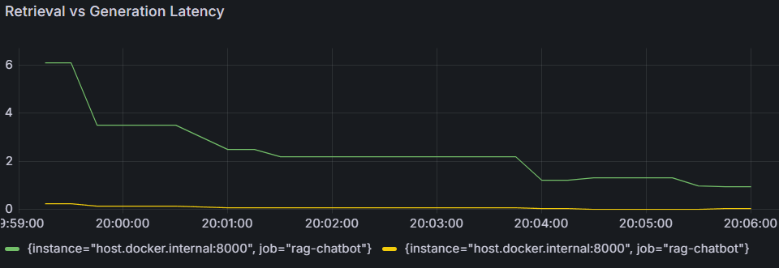
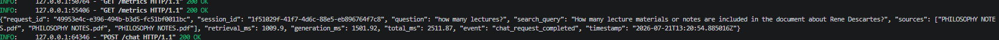
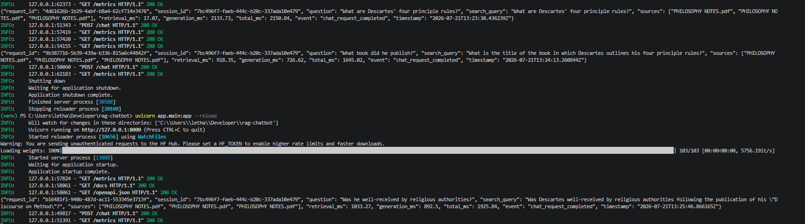
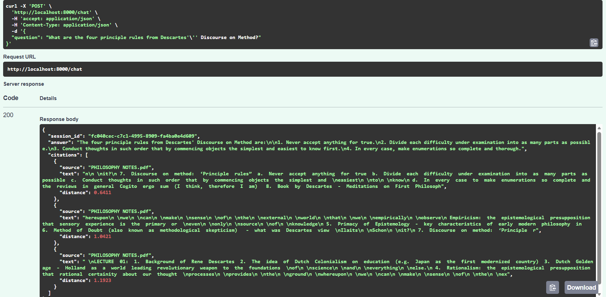

# RAG Chatbot API


A production-ready **Retrieval-Augmented Generation (RAG)** chatbot built with **FastAPI** and local LLMs. 

This project demonstrates backend API development, document chunking, vector search, query rewriting for multi-turn conversations, Redis-backed chat history, structured logging, and metrics collection using industry-standard observability tools.

---

# Dashboard Preview

<p align="center">
  
  
</p>

<p align="center">
  
  
</p>

<p align="center">
<i>Real-time performance monitoring, query rewriting for follow-ups, persistent chat history, and transparent citations.</i>
</p>

---

# Features

- Ingest PDFs and text files with automatic overlapping chunking
- Semantic search using local vector embeddings (sentence-transformers)
- Multi-turn conversations with LLM-powered query rewriting
- Local LLM generation via Ollama (zero API costs, full privacy)
- Redis-backed chat history with automatic 1-hour expiration
- Citations showing exact retrieved chunks and relevance distance scores
- Prometheus metrics split by pipeline stage (retrieval vs. generation)
- Structured JSON logging with structlog
- Automated testing using pytest

---

# Tech Stack

| Category | Technologies |
|----------|--------------|
| Backend | FastAPI |
| Vector Database | ChromaDB |
| Embeddings | sentence-transformers |
| LLM | Ollama (local) |
| Cache | Redis |
| Monitoring | Prometheus, Grafana |
| Logging | structlog |
| Testing | pytest |
| Containerization | Docker Compose |

---

# Project Structure

```text
rag-chatbot/
├── app/
│   ├── __init__.py
│   ├── main.py            # API endpoints + query rewriting logic
│   ├── embeddings.py      # Embedding model setup
│   ├── ingest.py          # Document chunking logic
│   ├── vectorstore.py     # ChromaDB operations
│   └── history.py         # Redis-backed chat history
│
├── documents/             # Source PDF          
├── tests/
│   └── test_rag.py
│
├── images/                
├── ingest_documents.py    # One-off ingestion script
├── docker-compose.yml
├── prometheus.yml
├── requirements.txt
└── README.md

```

---

# Quick Start

## Prerequisites

- Python 3.11+
- Docker Desktop
- Ollama installed and running


## Installation

Clone the repository.

```bash
git clone https://github.com/lithasz/rag-chatbot.git
cd rag-chatbot
```

Create a virtual environment.

### Windows

```bash
python -m venv venv
venv\Scripts\activate
```

### macOS / Linux

```bash
python3 -m venv venv
source venv/bin/activate
```

Install dependencies.

```bash
pip install -r requirements.txt
```

Pull a local LLM model.
```bash
ollama pull llama3.2
```

Start Redis, Prometheus, and Grafana.
```bash
docker compose up -d
```

Add your documents to the documents/ folder, then ingest them.
```bash
python ingest_documents.py
```

Run the FastAPI application.

```bash
uvicorn app.main:app --reload
```

---

# Access the Services

- FastAPI Documentation | http://localhost:8000/docs |
- Prometheus | http://localhost:9090 |
- Grafana | http://localhost:3000 |
- Redis | localhost:6379 |

---

# Architecture

```text
                        ┌──────────────┐
                        │    Client    │
                        └──────┬───────┘
                               │
                               ▼
                 ┌────────────────────────┐
                 │      FastAPI App       │
                 │  (with query rewrite)  │
                 └──────────┬─────────────┘
                            │
          ┌─────────────────┴──────────────────┐
          │                                    │
          ▼                                    ▼
 ┌──────────────────┐                 ┌──────────────────┐
 │   ChromaDB       │                 │     Redis        │
 │  (Vector Store)  │                 │ (Chat History)   │
 └──────────────────┘                 └──────────────────┘
          │                                    │
          ▼                                    │
 ┌──────────────────┐                          │
 │ sentence-        │                          │
 │ transformers     │                          │
 └──────────────────┘                          │
                                               │
          ┌─────────────────┬──────────────────┼─────────────────┐
          ▼                 ▼                  ▼                 ▼
  ┌────────────┐    ┌────────────┐    ┌────────────┐    ┌────────────┐
  │ Prometheus │    │  Grafana   │    │  structlog │    │   Ollama   │
  └────────────┘    └────────────┘    └────────────┘    │ (llama3.2) │
                                                        └────────────┘
```

The application consists of several components working together:

- **FastAPI** exposes the REST API and orchestrates the RAG pipeline.
- **ChromaDB** stores document chunk embeddings for fast similarity search.
- **Redis** persists multi-turn conversation history with auto-expiration.
- **Ollama** runs the local LLM for both query rewriting and answer generation.
- **Prometheus** scrapes stage-specific latency metrics from the /metrics endpoint.
- **Grafana** visualizes metrics through real-time dashboards.
- **structlog** produces structured JSON logs for debugging and monitoring.

---

# API Endpoints

- POST | `/chat` | Ask a question; optionally include session_id for follow-ups |
- GET | `/metrics` | Prometheus metrics endpoint |

---

# Rate Limiting

The API implements **Query Rewriting** to solve the multi-turn retrieval problem.

When a user asks a vague follow-up, the system uses the LLM to rewrite it into a standalone question before performing the vector search.

**Trade-off**: This adds one extra LLM call per follow-up, roughly doubling generation latency for multi-turn messages. This is intentionally measured and visible in the Grafana metrics.

Every response includes **Citations**, providing the exact retrieved chunk text and a Chroma distance score (where lower means more relevant), allowing users to verify answers against source material rather than trusting the LLM blindly.

---

# Monitoring

## Grafana

Grafana visualizes Prometheus metrics in real time, specifically tracking the distinct stages of the RAG pipeline.

The dashboards display:
- Retrieval latency (embedding + vector search, typically ~40ms)
- Generation latency (LLM response, typically ~1,800ms)
- Total request duration
- Success/error rates

<p align="center">

</p>

---

## Correlating metrics and logs

To demonstrate how monitoring helps identify bottlenecks, the system splits timing into retrieval_ms and generation_ms.

Observation: Generation consistently dominates total latency (>95%). This "find it → measure it → prove it" workflow demonstrates why optimization efforts in local RAG systems should focus on model selection or hardware, not vector search tuning.

<p align="center">

</p>

---

## Redis resistance proof
Chat history survives server restarts because it is stored in Redis, not in-memory.

Proof: Start a conversation, restart the server (Ctrl+C then re-run uvicorn), and send a follow-up with the same session_id. It still remembers the context.

<p align="center">

</p>

---

# Testing

Run the automated test suite.

```bash
pytest
```

The tests cover:

- Answer and citations returned correctly
- Citations include text and distance fields
- Session history persistence across requests
- Multi-turn conversation memory


---

# Future Improvements

- Simple HTML/React frontend to visualize citations
- Rate limiting for /chat (local LLM calls are CPU-expensive)
- Hybrid search (keyword + semantic)
- Document metadata filtering (date, category, author)
- CI/CD with GitHub Actions
- Kubernetes deployment

---

# What I Learned

Building this project gave me hands-on experience with:

- RAG Architecture: Understanding the full pipeline from chunking to generation
- Embeddings: How semantic search works numerically (cosine similarity)
- Vector Databases: Why specialized DBs are needed for similarity search
- Query Rewriting: Solving the multi-turn retrieval problem and its latency trade-offs
- Observability: Splitting metrics by pipeline stage to find actual bottlenecks
- Production Patterns: Citations, session management, and structured logging
- Building production-ready backend services

---

## License
This project was built for learning and portfolio purposes.
